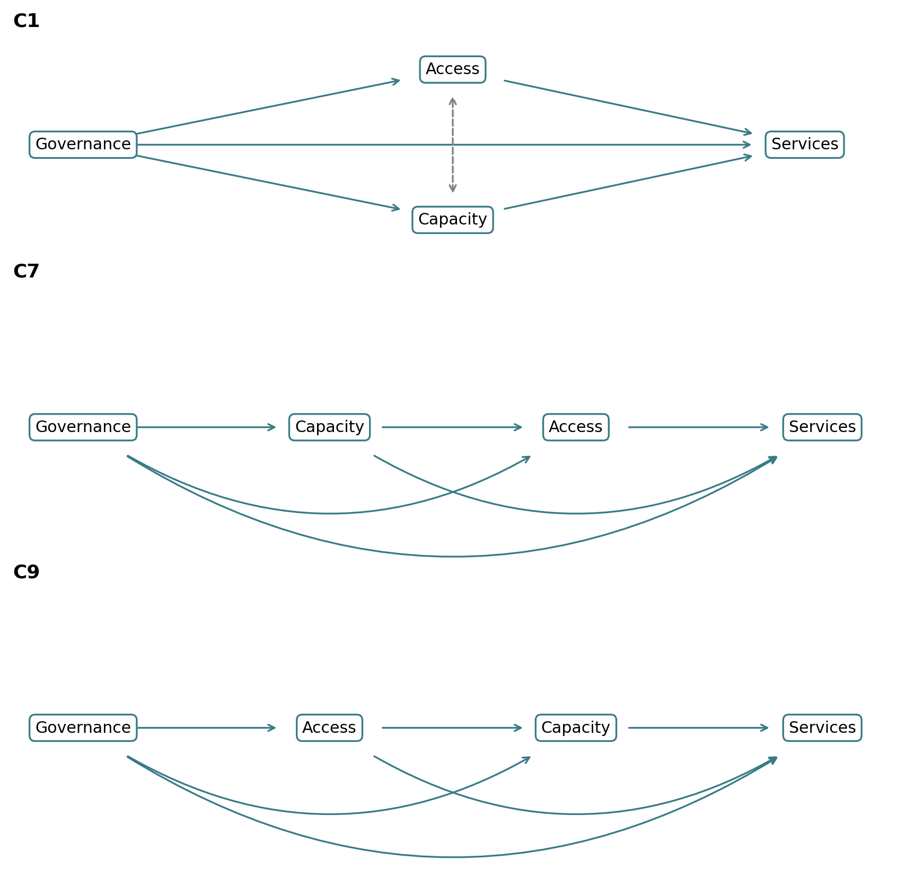
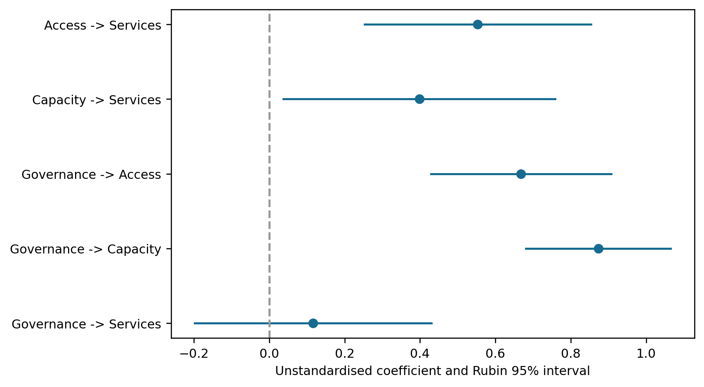

# Governance, medicine access and operational capacity associated with specialised adult palliative-care services: a cross-national analysis of WorldMap/WHO indicators

Fernando Cagigas and Laura Monzón

ATLANTES, Universidad de Navarra. Individual affiliations and corresponding-author details to be confirmed.

## Abstract

**Background.** National palliative-care indicators describe governance, medicines, professional activity and services. We examined their joint associations and dependence on analytical decisions.

**Methods.** This retrospective ecological cross-sectional analysis used WorldMap/WHO indicators. Curated Asia-Pacific was the primary population; all six WHO regions and the world provided contextual analyses. An Asia-Pacific I8 recoding was examined separately. Eight specifications and two samples were evaluated in a common execution. The primary model related governance to specialised adult-service development through medicine-access and operational-capacity components. Twenty imputations were used; coefficient pooling and 10,000-draw completed-dataset bootstrap uncertainty for path products were distinguished.

**Results.** The primary sample included 35 countries and territories; Europe included 51 and the world 184. The Asia-Pacific indirect sum was 0.717 (percentile 95% interval [0.346, 1.027]), whereas the access-minus-capacity difference was 0.022 ([-0.417, 0.696]). Its imputation-sensitivity points ranged from 0.719 to 0.725. The European sum was 0.413 ([0.215, 0.634]) and the world sum 0.405 ([0.300, 0.507]). Other regional sums had different precision and interval patterns. South-East Asia had 10 observations and did not meet the SEM sample-size threshold. Reversing the serial order in C7 and C9 changed pathway decomposition while preserving the governance total and indirect sum in the complete linear models.

**Conclusions.** Joint associations were positive in several populations, but individual pathway allocation and contextual generalisation remained uncertain. Equivalent totals under different serial orderings do not identify a developmental sequence. Coding differences, shared reporting, unmeasured context and the cross-sectional design prevent causal policy-effect claims.

## Keywords

Palliative care; health systems; governance; medicine access; cross-national study; ecological analysis; structural equation modelling; sensitivity analysis

## Background

Specialised palliative-care services are unevenly developed internationally. Access to pain relief and palliative care remains a health-system concern, while country-level indicators describe policy, medicines, professional activity and services [1] [2]. These domains may develop together, but their joint description does not reveal whether formal commitments, material access and operational activity are associated with the availability of specialised services in the same way.

The 2025 WorldMap provides a framework-based assessment and international ranking using WHO development indicators [3]. Its descriptive contribution establishes the setting for a different question: how do selected dimensions relate to specialised adult-service development when considered together? Our analysis does not create a replacement ranking, collect a new global survey or introduce a new statistical estimator. It examines relationships within an existing indicator framework and records how measurement and analytical decisions qualify those relationships.

Earlier international mapping linked levels of palliative-care development with national contextual characteristics, including income, human development and universal health coverage [4]. Such relationships make confounding by broader national development a central concern. A system with stronger governance may also have more resources, better information and more services. Conditional associations between the available palliative-care components cannot isolate policy effects from that context.

Applied studies offer complementary perspectives. A European comparative study of binding palliative-care laws distinguishes legal provisions from implementation and service performance [5]. Its design supports attention to that distinction; it does not identify the paths estimated here. Studies of advance care planning in Latin America and WHO indicator implementation in Benin emphasise country definitions, information sources and validation [6] [7]. Their findings do not validate our composite scores, but underline the importance of explaining what each national indicator represents. Population-based quantitative work on burdensome end-of-life care illustrates the value of defining an outcome before presenting multivariable associations [8]. Individual patient outcomes and national service-development scores remain different levels of analysis.

We asked how governance, medicine access and operational capacity are associated with specialised adult palliative-care services (I13), and how this description changes under the analytical sensitivities already performed. Our contribution is an applied analysis of these relationships, with explicit uncertainty and limitations. ATLANTES E4 supplies the reproducible analytical procedure for this application rather than a claim of universal methodological innovation.

## Methods

### Study design and data source

We conducted a retrospective secondary ecological cross-sectional analysis. Countries and territories, rather than patients or facilities, were the observations. Global scores came from the WorldMap supplementary input `_Global_2025.xlsx`, sheet `Scores_Finales`. The historical curated Asia-Pacific dataset came from `Dataset_Composites_PhD.xlsx`, sheet `Composites`, processed to `datasetfinal.csv`. ISO3 identifiers supported linkage and exclusion records. All empirical models were recalculated in the definitive October 2026 execution, including both samples and all active specifications. The editorial package reads that collection directly; no previous empirical edition supplies its numerical results.

The WorldMap source describes primary information gathering and assessment [3]. That validation is not assumed to remove all country reporting error or to validate the present component model. [AUTHOR INPUT: confirm authorised source versions, access conditions, and indicator-specific reference periods; do not infer simultaneous collection from the WorldMap publication year.] No independent data triangulation equivalent to the Latin American mixed-methods study is claimed here [6].

### Measures and operationalisation

Governance averaged national-plan, primary-care-integration and national-authority scores. Medicine access averaged opioid consumption, medicine availability and oral morphine. Operational capacity averaged education and research-activity subcomponents, each built from two indicators. These are observed scores with fixed arithmetic weights, not estimated latent variables. The capacity score represents selected professional and research activity, not a comprehensive workforce or service-readiness assessment.

Table 1. Measurement definitions in the analysed populations

| Dimension | Indicators | Construction |
| --- | --- | --- |
| Governance | I3 plan; I4 primary care; I5 authority | Mean of three scores |
| Medicine access | I8 opioids; I9 availability; I10 oral morphine | Mean of three scores |
| Capacity | I11/I12 education; I6/I7 research activity | Mean of two submeans |
| Services | I13 adult specialised services | Curated synthesis or global score |

Most scores use development levels from 1 to 4. Observed zeros in particular source fields are retained where implemented; the final components are clipped to [1,4]. Ordinal levels are treated numerically, implying equal spacing for this linear description without demonstrating that assumption. Reflective or formative labels in the catalogue are content assumptions, not evidence that a latent measurement model or cross-country invariance has been established [9] [10].

I13 is a specialised adult-service-development score. In curated Asia-Pacific it synthesises I13.P1 and a service-ratio level; other populations use the processed global score. Curated I8 uses regional opioid-consumption quartiles. These differences constrain cross-context comparisons. I13 does not measure effective coverage, service quality, equitable access, pain outcomes or patient experience.

I13 is not included arithmetically in any C1 predictor. The broader global development score, which includes I13, is not used as a structural predictor. Nevertheless, policy integration and service development may overlap conceptually, and national scores can share informants or reporting processes. Disjoint indicator lists do not demonstrate independent measurement error.

### Analytical populations

The primary analysis used curated Asia-Pacific, with all six WHO regions and the world as contextual analyses. The Asia-Pacific variant with globally coded I8 is a measurement sensitivity on the same curated cohort. This emphasis reflects the existing research sequence and was chosen retrospectively; it is not a preregistered preference or a selection justified by significance. World results provide broader context, but their global coding does not make them a larger interchangeable version of the curated primary dataset.

The implemented depuration rule excluded observations with at least five of fourteen indicators missing or an observed population below 100,000. Unknown population alone did not trigger exclusion. Original and analysed sample sizes are shown in Table 2; the supplement retains exclusion and missingness documentation. Regions are contained in the world population, so these are overlapping analyses rather than independent replications.

Table 2. Analytical populations and source differences

| Population | Original N | Cleaned N | Outcome coding |
| --- | --- | --- | --- |
| Curated Asia-Pacific | 41 | 35 | Curated I13 |
| Asia-Pacific I8 global | 41 | 35 | Curated I13 |
| Africa | 47 | 47 | Global |
| Americas | 35 | 30 | Global |
| Eastern Mediterranean | 22 | 22 | Global |
| Europe | 56 | 51 | Global |
| South-East Asia | 10 | 10 | Global |
| Western Pacific | 31 | 24 | Global |
| World | 201 | 184 | Global |

### Statistical analysis

The primary C1 specification used governance (G), medicine access (A), capacity (C) and I13 (Y), as illustrated in Figure 1:

$$
A=\alpha_A+a_1G+\varepsilon_A,\quad C=\alpha_C+a_2G+\varepsilon_C,
$$

$$
Y=\alpha_Y+c'G+b_1A+b_2C+\varepsilon_Y.
$$

The access/capacity residual covariance was allowed. Coefficients in the I13 equation condition on the other included components. No external socioeconomic variable was included in the structural equations. Development and regional auxiliaries in imputation do not constitute adjustment for income, human development, universal health coverage or other contextual confounders.

The ordering is an associative specification, not an identified temporal sequence. Derived quantities were EI1=a1b1, EI2=a2b2, their joint sum and their difference. “Indirect” denotes the mathematical path product. Causal mediation would require additional temporal, measurement and confounding assumptions unsupported by these data. An imprecise direct coefficient does not establish complete mediation. Flexible path-model fit cannot by itself establish the proposed ordering.

Primary runs used 20 imputations and root seed 42. Implemented imputation used BayesianRidge posterior IterativeImputer predictions, followed once by projection to a nearby observed donor (five candidates). Available development and regional information served as auxiliaries. The method is not asserted equivalent to a full chained-equations PMM implementation [11]. MAR and compatibility of imputation with the analysis are assumptions.

SEM coefficient estimates used likelihood-based complete-data fits, pooled using Rubin rules and declared asymptotic complete-data uncertainty [12] [13]. Indirect point estimates averaged equation-wise OLS products across imputations. They should not be reconstructed by multiplying the rounded SEM coefficients. Their uncertainty used 10,000 joint bootstrap draws in a balanced mixture across completed datasets, without reimputing resampled countries. Percentile and bias-corrected and accelerated (BCa) intervals were retained [14]. This completed-data procedure does not claim fully integrated MI uncertainty; the order of bootstrap and imputation matters [15] [16].

Bootstrap-tail probabilities were kept distinct from exclusion of zero by either interval. We report discrepancies rather than choose a favourable procedure or equate interval exclusion with a p-value threshold. The separate indirect sum and pathway difference use joint replicas, preserving their dependence. Estimates are unstandardised score-scale associations, not risk ratios or patient-level effects.

### Sensitivity analyses

Additional file 1 documents all populations, the eight active specifications C1–C5 and C7–C9, and the distinction between cleaned and complete samples. C6 remains withdrawn. C1 is primary retrospectively; C2–C5 and C7–C9 are exploratory families. Their family-specific BH adjustments remain in the original aggregation outputs; nominal intervals shown here are not multiplicity-adjusted.

C7 specifies governance → capacity → access → services, while the new C9 specifies governance → access → capacity → services. Both complete models retain all additional direct routes. C8 instead has correlated governance and capacity roots with access as the common intermediary; totals are defined separately by root. The complete models are primary and their restricted versions are comparators. A model with a different root or composite definition targets a different association.

Every estimable case in both samples received two alternative bootstrap streams (4,999 draws), nested 10- and 40-imputation analyses, an independent imputation seed of 43, and complete-case analysis (1,999 bootstrap draws for each MI/complete-case sensitivity). Delta shifts of ±0.5 changed only originally missing cells and were point diagnostics without new intervals. Fixed-imputation country omissions assessed influence without reimputation or confidence bands. Sample and I8 comparisons use the corresponding primary 10,000-draw outputs.

The complete-case adapter duplicates the same matrix to satisfy the pooling interface; it does not create independent imputations or duplicate countries. Other robustness, measurement and alternative-method tasks were also recalculated and remain available in the atlas. Their differing estimands and assumptions prevent treating agreement counts as independent votes.

### Reproducibility and reporting

The canonical collection is `20261018_definitiva`. Task markers retain output hashes and the identity of the full run or its repair segment. Two serialization/presentation defects were repaired and their complete dependency descendants recalculated; unchanged numerical tasks retain their original provenance. Input identity was stable in both segments. The collection contains 4420 successful and 446 non-applicable tasks, with no unresolved execution errors. Non-applicability is retained with a reason and does not mean a zero effect.

The editorial builder reads only this collection, verifies each consumed task output against its marker, and records source hashes and the numerical values used in text. All numerical tables are distributed as Additional file 2; the atlas exposes the full task originals. Two distinct C1 simulation designs were rerun and are reported separately as bounded computational support [17]. Neither calibrates every empirical SEM or the new C9 specification. Computational verification is distinct from independent scientific replication [18].

## Results

### Populations and measurement

The cleaned samples comprised 35 curated Asia-Pacific, 184 world, 47 Africa, 30 Americas, 22 Eastern Mediterranean, 51 Europe, 10 South-East Asia and 24 Western Pacific observations (Table 2). The I8 recoding uses the Asia-Pacific cohort again. Across nine analytical units, two samples and eight specifications, 144 combinations were represented; 128 had estimable primary SEM outputs and 16 were non-applicable. The latter were the eight South-East Asian specifications in both samples, with N below 15.

Missing-cell counts, observed resolution and exclusions are provided in the numerical supplement. Curated/global coding differences remain part of the analytical identity. A common execution does not make the populations or measurements interchangeable.

### Primary associations with adult-service development

Table 3 and Figure 2 present the Asia-Pacific C1 conditional coefficients. Access -> Services was entirely positive within its interval. Capacity -> Services was entirely positive within its interval. Governance -> Access was entirely positive within its interval. Governance -> Capacity was entirely positive within its interval. Governance -> Services was imprecise, with an interval including zero. These are associations conditional on the included components, without external socioeconomic adjustment.

Table 3. Asia-Pacific C1 coefficients and associative products

| Path or quantity | Point | Rubin or percentile 95% CI | BCa 95% CI |
| --- | --- | --- | --- |
| Access -> Services | 0.553 | [0.253, 0.853] | Not applicable |
| Capacity -> Services | 0.398 | [0.037, 0.759] | Not applicable |
| Governance -> Access | 0.668 | [0.429, 0.907] | Not applicable |
| Governance -> Capacity | 0.873 | [0.681, 1.065] | Not applicable |
| Governance -> Services | 0.116 | [-0.197, 0.430] | Not applicable |
| EI1 | 0.370 | [0.137, 0.692] | [0.126, 0.674] |
| EI2 | 0.347 | [-0.107, 0.637] | [0.060, 0.753] |
| Indirect sum | 0.717 | [0.346, 1.027] | [0.375, 1.048] |
| EI1 minus EI2 | 0.022 | [-0.417, 0.696] | [-0.495, 0.560] |

Coefficient rows use Rubin uncertainty from likelihood SEM; product rows use completed-dataset bootstrap intervals. The joint indirect sum was 0.717 (percentile 95% interval [0.346, 1.027]). The medicine-access and capacity products were 0.370 and 0.347, respectively; their difference was 0.022 ([-0.417, 0.696]). For the capacity product, the percentile interval was [-0.107, 0.637] and the BCa interval [0.060, 0.753]. The two procedures differed in zero inclusion. The difference does not establish a greater contribution of either route. Product estimates must not be reconstructed by multiplying rounded SEM coefficients.

### Sensitivity of the primary description

Across the examined imputation count/seed settings, the Asia-Pacific C1 indirect-sum points ranged from 0.719 to 0.725. Table 4 retains the primary and all eight common sensitivity settings rather than selecting them by interval direction. Delta shifts provide points only. Complete-case analysis changes selection together with missing-data handling.

Table 4. Asia-Pacific C1 indirect-sum sensitivity

| Setting | N | Indirect sum | Percentile 95% CI |
| --- | --- | --- | --- |
| Principal | 35 | 0.717 | [0.346, 1.027] |
| Bootstrap seed 1 | 35 | 0.717 | [0.360, 1.019] |
| Bootstrap seed 2 | 35 | 0.717 | [0.347, 1.021] |
| MI m=10 | 35 | 0.719 | [0.332, 1.015] |
| MI m=40 | 35 | 0.719 | [0.340, 1.021] |
| MI seed 43 | 35 | 0.725 | [0.357, 1.025] |
| Complete cases | 34 | 0.808 | [0.418, 1.090] |
| Delta -0.5 | 35 | 0.741 | Point only |
| Delta +0.5 | 35 | 0.698 | Point only |

Of the 6 common sensitivity rows with newly calculated percentile intervals, 6 had an interval entirely above zero. This is a descriptive count of related checks, not a binomial replication rate. Fixed-imputation country omission gave a sum range of 0.659 to 0.808; this range is a diagnostic, not a confidence interval. The two alternative bootstrap streams use the same imputed data and are not independent empirical replications.

In the serial models, the Asia-Pacific C7 serial product was 0.345 and the C9 serial product 0.125. Both complete-model indirect sums were 0.717. They share the I13 predictor set; the equality is an algebraic property of the complete linear decomposition, not evidence for a preferred temporal order. In particular, governance → access → services is an explicitly reported path in C9, alongside its longer serial path and the governance → capacity → services path.

### Regional overview and detailed supplementary results

C1 indirect-sum percentile intervals were entirely positive in Curated Asia-Pacific, Asia-Pacific I8 global, Europe, Western Pacific, World. They included zero in Africa, Americas, Eastern Mediterranean. Europe had a sum of 0.413 ([0.215, 0.634]), with access and capacity products of 0.134 and 0.278. South-East Asia remained non-applicable at the defined threshold. These different uncertainty patterns do not establish the equality or inequality of regional mechanisms.

Table 5. C1 indirect-sum estimates in every analytical unit

| Population | N | Point | Percentile 95% CI | BCa 95% CI |
| --- | --- | --- | --- | --- |
| Curated Asia-Pacific | 35 | 0.717 | [0.346, 1.027] | [0.375, 1.048] |
| Asia-Pacific I8 global | 35 | 0.751 | [0.346, 1.033] | [0.418, 1.075] |
| Africa | 47 | 0.104 | [-0.036, 0.281] | [-0.064, 0.258] |
| Americas | 30 | 0.183 | [-0.006, 0.387] | [-0.040, 0.356] |
| Eastern Mediterranean | 22 | 0.116 | [-0.097, 0.312] | [-0.117, 0.294] |
| Europe | 51 | 0.413 | [0.215, 0.634] | [0.219, 0.639] |
| South-East Asia | 10 | Not applicable | N below 15 | N below 15 |
| Western Pacific | 24 | 0.721 | [0.230, 1.192] | [0.189, 1.171] |
| World | 184 | 0.405 | [0.300, 0.507] | [0.302, 0.509] |

Additional file 1 contains a dossier for every population, all case definitions, model applicability, and interpretation of sensitivities. Additional file 2 contains all unrounded coefficients, indirect quantities, scenario results, country omissions, diagnostics and simulation summaries. Figure 3 displays the regional C1 sums. Differences between displayed estimates are not formal regional contrasts: countries overlap and curated Asia-Pacific measurements differ from global scores.

## Discussion

### Substantive interpretation

The primary analysis describes co-development of governance, medicine access, selected professional capacity and specialised adult services. Its joint associative pattern is compatible with the view that formal governance accompanies material and operational dimensions of service development. Compatibility is weaker evidence than an identified mechanism: a common level of national development, reverse association, policy responses to existing services or shared reporting could produce similar patterns.

Formal policies and operational implementation should therefore be distinguished. The European legal comparison reinforces that distinction in a different design [5]. A country can report a plan or authority while facing obstacles in medicines, workforce preparation or delivery. Conversely, services and professional networks may precede formal policy. Our direct governance interval cannot decide between these trajectories, and an indirect product cannot demonstrate policy implementation over time.

Medicine availability and professional activity offer practically relevant dimensions for describing systems [2] [7]. However, these scores do not measure all barriers to access or all aspects of operational readiness. Congresses and publications may reflect reporting visibility or research concentration rather than widespread service capacity. Their contribution to a single score requires content justification, not merely a satisfactory model fit.

### Contribution relative to international mapping

WorldMap characterises national development and rankings [3]. This study addresses relationships among selected dimensions and I13 within explicit populations, with uncertainty and sensitivity rather than a new ranking. Its substantive added value rests on the distinction between a relatively stable joint primary association and less certain pathway allocation, alongside contextual and analytical qualifications. Statistical complexity is not itself the novelty.

Earlier mapping's relationships with contextual development [4] are especially relevant. Our component-conditional associations leave those external relationships unresolved. The applied literature also illustrates why source validation and the level of analysis matter [6] [8]. Country-level associations cannot be interpreted as evidence about the treatment, access or outcomes of individual patients [19].

### Regional interpretation and follow-up

The regional dossier makes the differing patterns and their evidence status visible without treating every region as a replication. Positive joint descriptions, uncertain pathway allocation, imprecise estimates and non-estimable models require different follow-up questions. All regions now use the same execution and sensitivity schedule when estimable. South-East Asia remains non-estimable under the stated SEM threshold; its descriptive information is retained. Regional investigation should distinguish differences in implementation and resources from changes in coding, selection and information quality. It should also disclose overlap with this analysis and establish a distinct question when reusing countries or estimates.

### Implications for health-system research

The findings suggest studying governance, medicines and selected capacity together when describing the development of specialised services, while avoiding a ranking of intervention priorities from these coefficients. They motivate longitudinal and contextual work examining whether formal commitments are implemented, what resources accompany them and which barriers remain. They do not estimate the expected effect of changing one national score or establish an optimal policy sequence.

For reporting, uncertainty should remain attached to its procedure and population. The present capacity-path discrepancy means that different interval or tail rules can support different statements. Retaining it makes interpretation more defensible than selecting the most favourable result. The framework is useful here as an organised, traceable analytical process; its universal performance has not been demonstrated.

### Limitations

The cross-sectional ecological design cannot establish temporal order, causal mediation or individual effects. Unmeasured national development, financing and health-system organisation may confound the observed relationships. The primary structural model contains no external socioeconomic adjustment. The supplementary contextual and alternative-method analyses have different specifications; they do not retrospectively adjust the primary model or remove residual confounding.

Scores are ordinal, heterogeneous and potentially correlated through informants and conceptual content. Equal-weight observed components are not latent constructs validated by this analysis. I13 is a service-development proxy, with curated/global differences, and does not quantify effective coverage, quality or equity. The retrospective primary-population choice and overlapping contextual samples limit generalisation.

Small regional samples can make path estimates and indirect intervals unstable. MAR, imputation-model compatibility and asymptotic coefficient uncertainty remain assumptions. Bootstrap draws condition on completed datasets without fresh imputation; the reported intervals are not a demonstration of total-uncertainty calibration. Existing sensitivities cover selected decisions and cannot exclude every measurement or missingness bias. The two simulation designs omit features of the empirical scores and support only their stated estimands and settings; neither establishes calibration for every region or C9.

## Conclusions

Within curated Asia-Pacific, governance, medicine access and operational capacity showed a positive joint associative relationship with specialised adult palliative-care service development. The examined sensitivities supported this joint description more consistently than individual pathway allocation. Global and regional analyses offered different, sometimes imprecise patterns and were not interchangeable replications.

These findings encourage close examination of the region-specific estimates, sensitivities and limitations in Additional file 1, and further regional studies grounded in local policy, medicine access and professional-capacity contexts. Such studies should harmonise indicators, assess socioeconomic confounding and temporal relationships, and connect service development with implementation and effective access. Small or currently non-estimable populations require stronger data rather than causal or null-effect conclusions. The present comparisons motivate these questions; they do not establish a universal pathway or an intervention priority ranking.

## Figure legends

{width=95%}

{width=95%}

{width=95%}

## Declarations

### Ethics approval and consent to participate

[AUTHOR INPUT: institutional determination for this secondary country-level analysis and source permissions. No exemption is assumed.]

### Consent for publication

[AUTHOR INPUT: applicability and confirmed statement.]

### Availability of data and materials

Code and derived results are maintained in https://github.com/Fercagigas/WorlMap-System-Drivers. [AUTHOR INPUT: lawful original-data access, redistribution permissions, reviewer access, code licence and persistent versioned deposit.] Public visibility or unrestricted data rights are not assumed. Editorial reconstruction is verified separately from full statistical replication.

### Competing interests

[AUTHOR INPUT: verified disclosures for every author.]

### Funding

[AUTHOR INPUT: funders, grant identifiers and roles, or confirmed absence of funding.]

### Authors' contributions

[AUTHOR INPUT: approved authorship and contributor roles.]

### Acknowledgements

[AUTHOR INPUT: approved acknowledgements.]

### AI assistance

AI assistance was used in code and editorial preparation, including this draft. [AUTHOR INPUT: verify tools, versions, scope and required disclosure; confirm human review of scientific claims, code, figures, references and all final text.] AI is not an author.

## References

1. Knaul Felicia Marie, Farmer Paul E, Krakauer Eric L, De Lima Liliana, Bhadelia Afsan, Jiang Kwete Xiaoxiao. et al. Alleviating the access abyss in palliative care and pain relief—an imperative of universal health coverage: the Lancet Commission report. The Lancet. 2018. https://doi.org/10.1016/s0140-6736(17)32513-8

2. World Health Organization . Assessing the development of palliative care worldwide: a set of actionable indicators. Geneva: WHO. 2021. https://www.who.int/publications/i/item/9789240033351

3. Tripodoro Vilma A., Fidalgo Jesús Fernando López, Pons Juan José, Connor Stephen R., Garralda Eduardo, Bastos Fernanda. et al. First-Ever Global Ranking of Palliative Care: 2025 World Map Under the New WHO Framework. Journal of Pain and Symptom Management. 2025. https://doi.org/10.1016/j.jpainsymman.2025.07.026

4. Clark David, Baur Nicole, Clelland David, Garralda Eduardo, López-Fidalgo Jesús, Connor Stephen. et al. Mapping Levels of Palliative Care Development in 198 Countries: The Situation in 2017. Journal of Pain and Symptom Management. 2020. https://doi.org/10.1016/j.jpainsymman.2019.11.009

5. Carpén Timo P, Monzón-Llamas Laura, Hannon Breffni L, Pawłowski Leszek, Saarto Tiina H, Pöyhiä Reino T. et al. National palliative care laws in Europe: do they enable access and effectively promote the development of palliative care within health systems? A comparative multimethod analysis. European Journal of Public Health. 2026. https://doi.org/10.1093/eurpub/ckag147

6. Tardelli Natália Rocha, Fukushima Fernanda Bono, van der Steen Jenny T., Rodríguez Manuel Iván Cobas, Mikelyte Rasa, Forte Daniel Neves. et al. Mapping advance care planning and advance directives in Latin America. BMC Palliative Care. 2025. https://doi.org/10.1186/s12904-025-01849-5

7. Agbodande Kouessi Anthelme, Gnangnon Freddy, Assogba Mickael, Avakoudjo Josué, Azon Kouanou Angèle, Odoulamy Lisette. et al. Palliative care progress in Benin: a situation analysis using the WHO development indicators. BMC Palliative Care. 2024. https://doi.org/10.1186/s12904-024-01473-9

8. Mitchell Rebecca J, Delaney Geoffrey P, Arnolda Gaston, Liauw Winston, Phillips Jane L, Lystad Reidar P. et al. Potentially burdensome care at the end-of-life for cancer decedents: a retrospective population-wide study. BMC Palliative Care. 2024. https://doi.org/10.1186/s12904-024-01358-x

9. Bollen Kenneth, Lennox Richard. Conventional wisdom on measurement: A structural equation perspective.. Psychological Bulletin. 1991. https://doi.org/10.1037/0033-2909.110.2.305

10. Saisana M., Saltelli A., Tarantola S.. Uncertainty and Sensitivity Analysis Techniques as Tools for the Quality Assessment of Composite Indicators. Journal of the Royal Statistical Society Series A: Statistics in Society. 2005. https://doi.org/10.1111/j.1467-985x.2005.00350.x

11. Buuren Stef van, Groothuis-Oudshoorn Karin. mice: Multivariate Imputation by Chained Equations inR. Journal of Statistical Software. 2011. https://doi.org/10.18637/jss.v045.i03

12. Rubin Donald B.. Multiple Imputation for Nonresponse in Surveys. Wiley Series in Probability and Statistics. 1987. https://doi.org/10.1002/9780470316696

13. Barnard J, Rubin DB. Miscellanea. Small-sample degrees of freedom with multiple imputation. Biometrika. 1999. https://doi.org/10.1093/biomet/86.4.948

14. Efron Bradley. Better Bootstrap Confidence Intervals. Journal of the American Statistical Association. 1987. https://doi.org/10.1080/01621459.1987.10478410

15. Schomaker Michael, Heumann Christian. Bootstrap inference when using multiple imputation. Statistics in Medicine. 2018. https://doi.org/10.1002/sim.7654

16. Bartlett Jonathan W, Hughes Rachael A. Bootstrap inference for multiple imputation under uncongeniality and misspecification. Statistical Methods in Medical Research. 2020. https://doi.org/10.1177/0962280220932189

17. Morris Tim P., White Ian R., Crowther Michael J.. Using simulation studies to evaluate statistical methods. Statistics in Medicine. 2019. https://doi.org/10.1002/sim.8086

18. Sandve Geir Kjetil, Nekrutenko Anton, Taylor James, Hovig Eivind. Ten Simple Rules for Reproducible Computational Research. PLoS Computational Biology. 2013. https://doi.org/10.1371/journal.pcbi.1003285

19. Morgenstern Hal. Ecologic Studies in Epidemiology: Concepts, Principles, and Methods. Annual Review of Public Health. 1995. https://doi.org/10.1146/annurev.pu.16.050195.000425

20. Bareinboim Elias, Pearl Judea. Causal inference and the data-fusion problem. Proceedings of the National Academy of Sciences. 2016. https://doi.org/10.1073/pnas.1510507113
